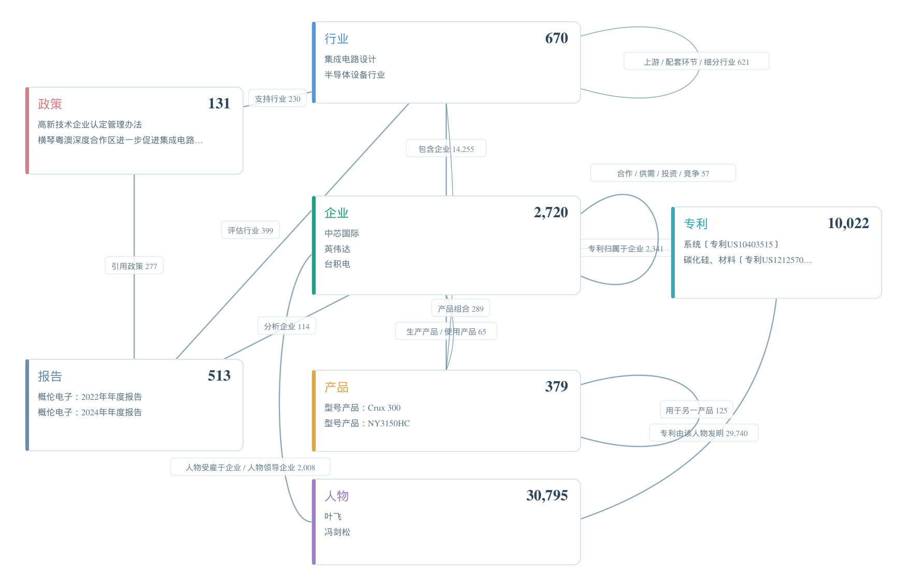

# ICKG · 产业链知识图谱

半导体产业链数据与七层图谱，覆盖行业、企业、产品、政策、专利、报告和人物。

[在线图谱](https://tianzeshu.github.io/ICKG/) · [数据使用说明](DATA_USE.md) · [引用信息](CITATION.cff)

## 使用

- **在线查看**：[打开七层时序图谱](https://tianzeshu.github.io/ICKG/)，支持层级高亮、日期区间及双快照切换。
- **下载数据**：[下载整个仓库](https://github.com/tianzeshu/ICKG/archive/refs/heads/main.zip)，实验集与全量集位于不同目录。全量的 gzip 文件解压后为 UTF-8 JSONL 或 CSV。
- **离线查看**：下载仓库后，双击 <code>docs/index.html</code>，无需安装环境。

## 数据版本 / Datasets

| 目录 | 来源与范围 | 规模 |
| --- | --- | ---: |
| [实验子集 v5](data/experimental/README.md) | 用户提供的 `ICKG_Semiconductor_v5.zip`，保留原 train/dev/test | 23,895 关系行 |
| [全量 v4 · current](data/full/current/) | 公开证据与当前观察汇集，快照日期 2026-10-28 | 45,230 正式节点；47,406 去重核心时序四元组 |
| [全量 v4 · asof-2025](data/full/asof-2025/) | 公开证据截至 2025-12-31 的历史视图 | 43,940 正式节点；36,423 去重核心时序四元组 |

实验子集的原划分为 train **19,116**、dev **2,389**、test **2,390** 行，文件内容和划分边界保留。它使用名称端点及原始关系标签；全量图谱使用稳定实体 ID、本体关系、证据定位及时间字段。两部分来源、schema 和版本独立，不宣称严格包含关系，也不将本次公开数据统计当作论文固定实验指标。

实验数据的字段、已知限制及完整性校验见其 [README](data/experimental/README.md) 与 [manifest](data/experimental/manifest.json)。全量文件和时间口径见 [全量数据说明](data/full/README.md)、[current manifest](data/full/current/manifest.json) 与 [asof-2025 manifest](data/full/asof-2025/manifest.json)。

## 七层规模 / Seven Layers

| 层 | current（2026-10-28） | asof-2025 |
| --- | ---: | ---: |
| 行业 Industry | 670 | 252 |
| 企业 Company | 2,720 | 1,853 |
| 产品 Product | 379 | 379 |
| 政策 Policy | 131 | 126 |
| 专利 Patent | 10,022 | 10,022 |
| 报告 Report | 513 | 513 |
| 人物 Person（含专利发明人） | 30,795 | 30,795 |
| **合计** | **45,230** | **43,940** |

全量区分事实时间与来源公开/观察时间，未知事实时间保留未知。行业主树与展会产品分类维度分开组织。数据经过证据、结构和辅助语义复核，未标为人工金标准。

## 图谱预览 / Preview

下图为全量图谱 **SVG 导出渲染图**；交互筛选与双快照切换请使用[在线图谱](https://tianzeshu.github.io/ICKG/)。

## 关联论文与贡献者

田泽庶、白佳敏、张宏莉：《**多层次时序产业链知识图谱构建方法研究**》，软件学报稿件。正式发表信息、年份、卷期、页码及 DOI 待核实。

贡献者按论文作者顺序列示：**田泽庶、白佳敏、张宏莉**；单位：**哈尔滨工业大学计算学部**。

引用仓库时请同时注明所用数据版本和快照，参考 [CITATION.cff](CITATION.cff)。

## 发布与使用

公开全量包与网页保留正式节点、关系、分类结构以及来源 URL、哈希和证据坐标，不随包分发第三方报告全文或原图。原始本地大 ZIP 不直接提交到仓库。第三方资料的权利及组件许可见 [DATA_USE.md](DATA_USE.md)。
